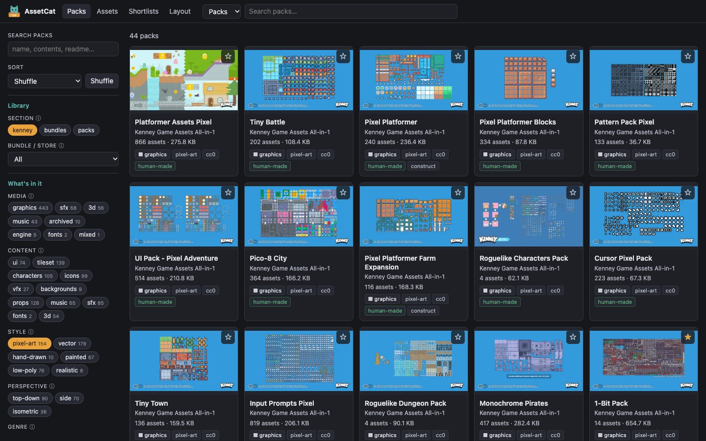
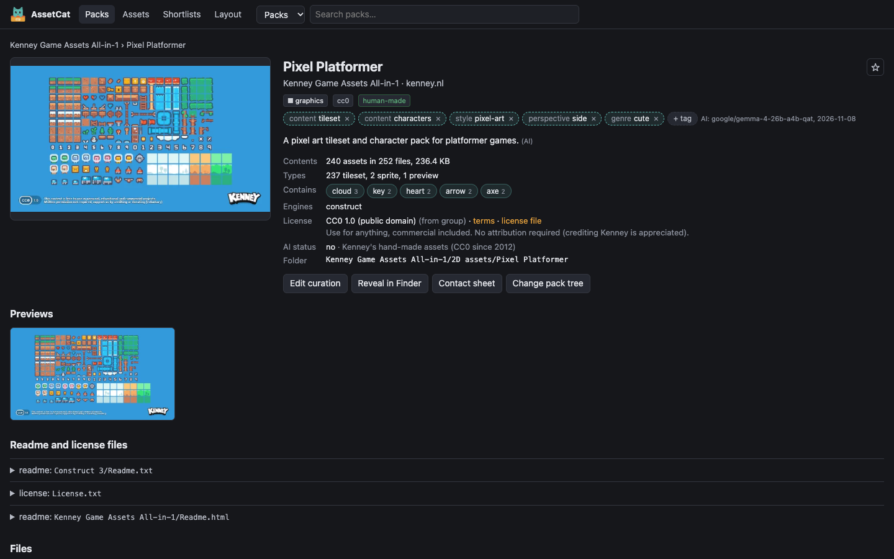
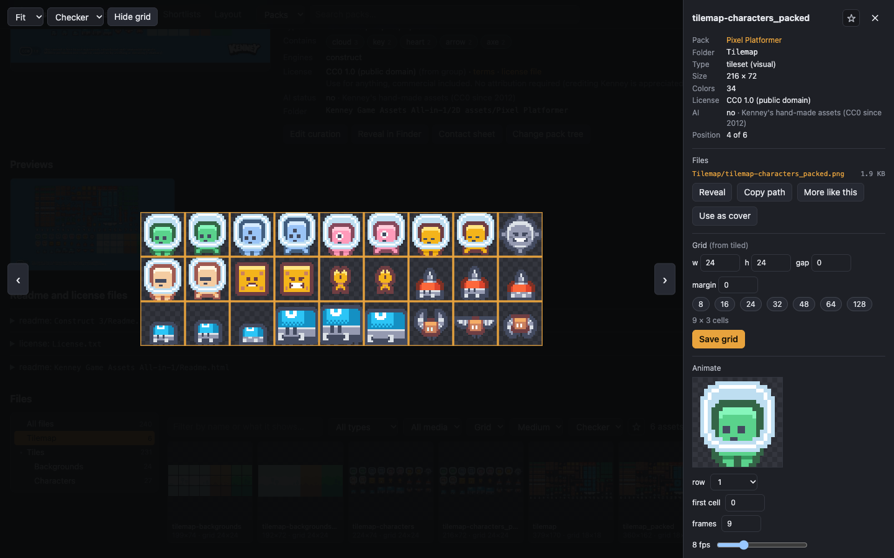
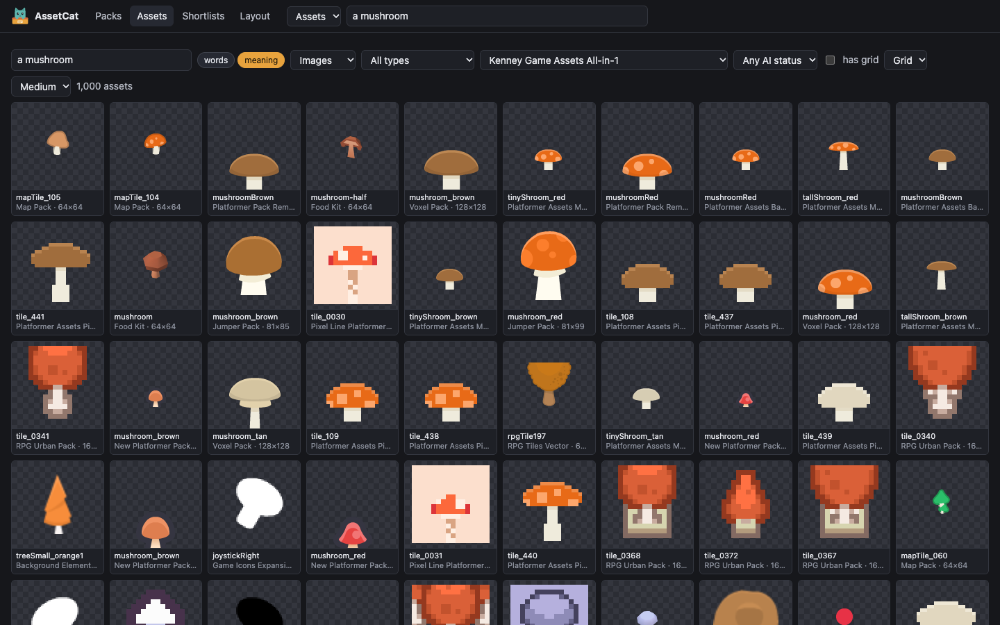
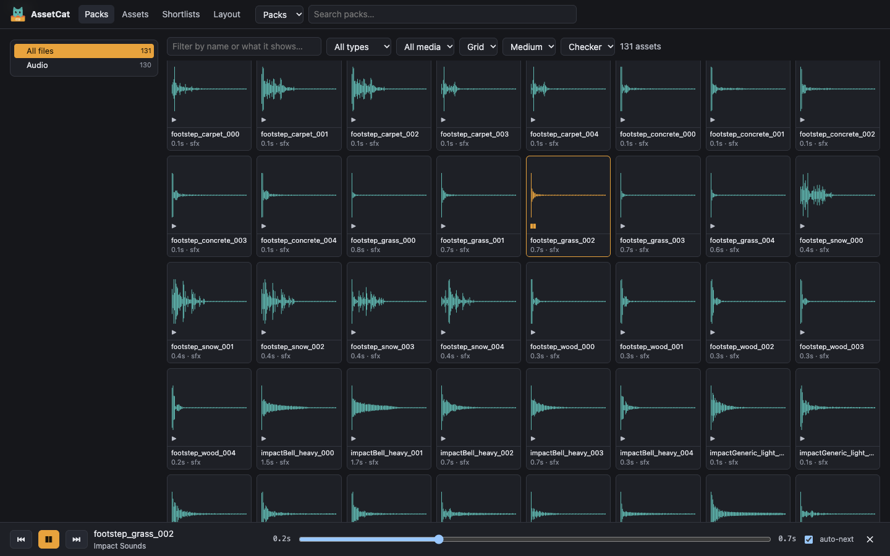
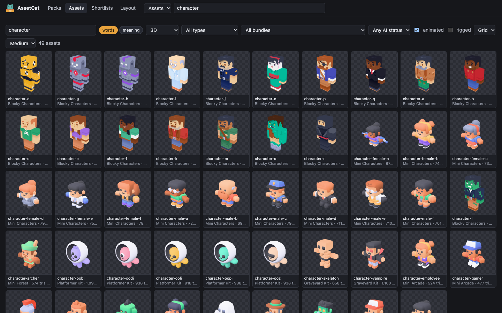
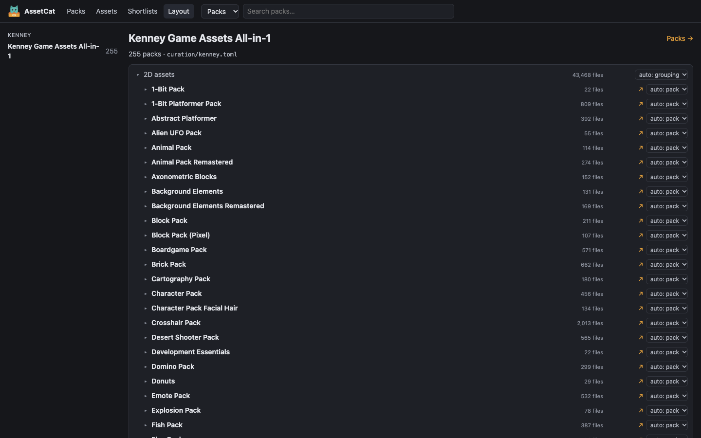

<p align="center"></p>

# AssetCat

If you've collected game assets for a while (Humble bundles, Kenney's all-in-1, itch.io and
store packs), you probably have hundreds of packs and hundreds of thousands of files, and no
good answer to "do I own a pixel-art dungeon tileset, may I use it commercially, and is it
AI-generated?"

`assetcat` indexes a library like that and lets you browse it in a local web UI or search it
from the command line. What you know about the library (each bundle's license, whether a pack
is human-made and why you believe so, notes, tags, shortlists) lives in **plain TOML files next
to the library**, so it syncs with it, diffs cleanly and survives any rebuild of the index.

The story behind it (why I built it and how it works with local AI) is in
[this GammaVibe post](https://gammavibe.substack.com/p/assetcat-finding-the-right-game-asset).

- **Licenses and AI provenance:** set them once per bundle or store, override per pack; every
  pack and file shows what applies and where it came from.
- **Browse:** a wall of pack covers, a pack page with its readme and license, an image viewer
  that knows sprite sheet grids (and plays rows as animations), an audio player, fonts in their
  own typeface, and 3D models (glTF/GLB, OBJ, best-effort FBX) you can turn around, with their
  animation clips.
- **Search:** full-text over pack names, folders, file names and readmes; filter by type
  (sprite, sheet, tileset, ui, sfx, music...), size, license and AI status; 3D models by
  animated or rigged.
- **Search by meaning (optional):** describe what you want ("a slime monster", "wooden door")
  and get the images that show it, whatever their file names; or open an image and ask for
  **more like this**. The same model notes what single images show (potion, sword, bread), so
  word search finds `item_37.png` and pack pages list what a pack contains.
- **AI tags (optional):** a local vision model looks at each pack and tags its kind, style,
  perspective and genre (`style:pixel-art`, `perspective:top-down`), so you can filter by them.
  You can remove or add tags with one click, and your changes survive any re-run.
- **Pull into a project:** copies files with their license and writes a manifest with credit
  lines; a 3D model brings the textures it loads. A Claude Code skill does the searching and
  pulling for you.
- **Read-only:** your library is never modified. The only folder AssetCat writes in it is its
  own profile folder.



**Expectations:** AssetCat was built for one real library first (bundles, store packs and
Kenney) and is generalized as other libraries show up. Yours will probably need a few
corrections to how folders become packs, which the browse UI lets you make. If something
doesn't work for your library, please [open an issue](https://github.com/digitalhobbit/assetcat/issues).

**Contributing:** I'm not taking pull requests for now, so the code stays consistent as it
evolves. Feature requests are very welcome: [open an issue](https://github.com/digitalhobbit/assetcat/issues)
describing what you need, ideally with a draft prompt for a coding agent that would build it.

## Install

With [uv](https://docs.astral.sh/uv/) (it fetches Python 3.12+ if you don't have it):

```sh
uv tool install assetcat
```

or try it without installing: `uvx assetcat --help`. `pipx install assetcat` and `pip install
assetcat` (Python 3.12+) work too. The latest unreleased version:
`uv tool install git+https://github.com/digitalhobbit/assetcat`. Runs on macOS, Windows and Linux.

## Getting started

```sh
assetcat init ~/Assets      # 1. the folder that holds your asset folders
assetcat index              # 2. read the library (the first run takes a few minutes on a big one)
assetcat serve --open       # 3. browse it at http://127.0.0.1:8765/
```

1. `init` looks at your top-level folders, guesses a layout, and writes a **profile** folder in
   `<library>/assetcat/`. It prints what it guessed; read it, and adjust `catalog.toml` in the
   profile if a section looks wrong (see [How folders become packs](#how-folders-become-packs)).
2. `index` reads every file's header (sizes, frames, durations, fonts, readme text), finds
   sprite sheet grids and duplicates across bundles, and renders a contact sheet per pack.
   Later runs only read what changed, so re-run it whenever you add assets.
3. In the browse UI, check that packs look like packs. Where they don't (a bundle shown as one
   giant pack, or a pack split into its sub-folders), open **Layout** and fix it.
4. Record licenses and AI status: open a pack, **Edit curation**, and fill in the
   **Bundle defaults** first; most packs inherit them.
5. Run `assetcat doctor` to see what's left to do. Each problem comes with how to fix it.
6. Optionally, tag packs with a local AI model ([AI tags](#ai-tags)) and make images searchable
   by what they show ([Search by meaning](#search-by-meaning)).

## The browse UI

A pack page shows the pack's tags, previews, readme and license, where its license and AI status
come from, what its images show, and its files by folder:



The viewer scales pixel art by whole numbers, overlays the sheet's grid (read from Tiled, atlas
or Kenney files or a size in the file name, or set by you) and plays a row as an animation:



Asset search covers the whole library, filtered by type, media, bundle and AI status. Search by
words, or by meaning to find images by what they show:



Sound and music show as waveforms. Click one to play it in the player bar, which can go on to
the next one by itself (*auto-next*):



3D models (glTF/GLB, OBJ, and FBX on a best-effort basis) show as rendered tiles. The viewer
lets you turn a model around, switch between its formats and play its animation clips. Search
can narrow 3D models to animated or rigged ones:



Star packs, folders or single assets to collect them in shortlists (plain TOML in the
profile), for example to hand a set of candidates to Claude in a game project.

## How folders become packs

The profile's `catalog.toml` lists **sections**, one per top-level folder:

```toml
[[sections]]
name = "bundles"
folder = "Bundles"
layout = "groups"            # each folder inside is a group (a bundle or a store) holding packs

[[sections]]
name = "kenney"
folder = "Kenney Game Assets All-in-1"
layout = "single-group"      # the whole section is one group...
pack_depth = 2               # ...with packs at <category>/<pack>
```

Inside a group, every folder gets a **role**:

- **grouping:** just a folder (`Graphics/`, `Audio/`); its sub-folders are looked at for packs.
- **pack:** one pack; everything inside belongs to it.
- **collection:** a pack whose sub-folders are packs too (a "mega pack" of several packs).
- **ignore:** not indexed at all.

AssetCat guesses roles from folder names and contents (previews, readmes and licenses mark a
pack). When it guesses wrong, the **Layout** page in the browse UI shows each group's folders
with their roles; change one and the tree below shows the result before you save. Roles are
saved in the group's curation file, and the page re-indexes to apply them.



## Licenses and AI provenance

`index` creates one curation file per group in the profile's `curation/` folder. Edit it in the
browse UI (which keeps your comments and formatting) or by hand:

```toml
store = "Example Store"
purchased = 2020
license = "cc-by-4"                 # a key in licenses.toml
ai_generated = "no"                 # yes | no | unknown
ai_reason = "Released in 2017, before generative art tools"

[packs."graphics/forest-tiles"]     # per-pack overrides, keyed by folder (the Layout page shows keys)
license = "cc0"
tags = ["forest", "pixel-art"]
cover = "Preview/cover.png"
grid = { "tiles/forest.png" = [16, 16] }
```

Values inherit: a pack takes its group's license and AI status unless it sets its own, and the
packs inside a collection inherit from the collection. `licenses.toml` holds your license table
(CC0, CC BY and a few common store licenses to start with); add one entry per license you own
assets under. Its summaries are reminders, not legal advice: check the terms that came with your
purchase before you ship.

`ai_generated = "no"` is the claim "a human made this", and `ai_reason` is why you believe it:
the release date, the artist, the store's policy. With storefronts asking about AI content and
players caring, that reason is worth writing down while you still remember it.

## AI tags

`assetcat classify` shows each pack to a vision-language model running on your machine and
stores the tags it answers with in the profile. For each pack, the model gets the cover and
contact sheet, plus what the index knows: the pack's name, folders, file formats and image sizes,
and an excerpt of its readme. It answers only with values from the profile's `tags.toml`, which
you can extend. With the recommended model, a pack takes about 4 seconds on an M4 Pro Mac (850
packs in about an hour), and later runs only tag packs that are new or changed.

It talks to any OpenAI-compatible server. The simplest is [LM Studio](https://lmstudio.ai/):

1. Install LM Studio, search for a model (below) and download it.
2. Start its local server: the Developer tab, or `lms server start`.
3. Try the model on a few packs (nothing is saved), then tag everything:

```sh
assetcat config ai_model google/gemma-4-26b-a4b-qat   # once per machine
assetcat classify --sample 10                          # print tags for 10 random packs
assetcat classify                                      # tag every pack; stop and resume anytime
```

| Model | Download | Notes |
|---|---|---|
| Gemma 4 26B-A4B, QAT 4-bit | ~16 GB | Recommended. Best at telling pixel art, vector and 3D apart; ~3.5 s per pack on an M4 Pro |
| Gemma 4 E4B | ~5 GB | For machines with 16 GB of memory or less. Faster, but gets style wrong more often |

Other models and servers work too: any model that takes images (a "vision" model) and a server
with an OpenAI-compatible API, such as Ollama (`assetcat config ai_url
http://127.0.0.1:11434/v1`), llama.cpp's server or a cloud API (put the key in
`ASSETCAT_AI_KEY`). Use `--sample` to see how a model does on your packs before a full run.
Each model's results are kept apart (`ai/<model>/` in the profile), and the newest result per
pack is the one shown.

AI tags show dashed on the pack page; yours are solid. Removing an AI tag records it in the
curation file (`tags_remove`), and adding one records it in `tags`, so a re-run never undoes your
edits. Both work at bundle level too, by hand: `tags_remove = ["genre:fantasy"]` on a group
removes that tag from all its packs. Changing `tags.toml` marks the earlier tags outdated, and
the next `classify` redoes them.

## Search by meaning

`assetcat classify --kind embed` runs an image-text model (Google's SigLIP 2) over every image
and stores one vector per image in the profile. Then you can search by description, in the
browse UI (switch the asset search from *words* to *meaning*) or from the command line, and find
images that look like a given one:

```sh
uv tool install --force "assetcat[ai]"     # adds PyTorch
assetcat classify --kind embed            # the model downloads on first use (~1.5 GB, shown)
assetcat search --meaning a slime monster --type character,sheet
assetcat search --similar "Kenney Game Assets All-in-1/2D assets/Tiny Dungeon/Tiles/tile_0100.png"
```

Describe what you want in a few words, style included: "a pixel art slime monster" finds more
than "slime". Sprite sheets and animation strips are searched by their frames, not as a whole.

The model runs inside AssetCat, no server needed. It uses an NVIDIA GPU or Apple Silicon when
there is one, and the CPU otherwise (much slower). On an M4 Pro Mac it does about 115 images a
second, so about 200,000 images take half an hour; duplicates are done once, and later runs only
add new images. On Windows, PyPI's PyTorch is CPU-only; for an NVIDIA GPU, install the CUDA build
instead, which uv picks to match your driver:

```sh
uv tool install --force --torch-backend auto "assetcat[ai]"
```

`classify --kind embed` says which device it uses ("... on cuda").

The default model is `google/siglip2-base-patch16-256`. Larger SigLIP 2 models
(`siglip2-large-patch16-256`, `siglip2-so400m-patch16-256`) find a little more on hard queries
and take 3-4 times as long: `assetcat config embed_model <name>`, then `classify --kind embed`
again. Vectors are kept per model, about 350 MB for 200,000 images.

**Subjects.** The same vectors also say what an image shows: each image is scored against "a
potion", "a sword" and the rest of the `subject` list in `tags.toml` (about 130 common game
subjects). Subjects above a confidence threshold are added to word search, shown in the image
viewer ("Shows: bread 43%") and counted per pack ("Contains: bottle 4, bread 3, apple 2"). It's
cautious on purpose: about one image in ten gets a subject, and tiny tiles rarely do. Add your own
subjects to the list and run `classify --kind embed` again; it re-scores the stored vectors in
seconds without reading any images. A threshold change only needs `assetcat index`. "More like
this" needs only the stored vectors; searching by a typed description also needs the model (and
the `ai` extra) on the machine you search on.

## The profile

```
<library>/assetcat/
├── catalog.toml        sections, junk file names, grouping folder names
├── licenses.toml       your license table
├── tags.toml           tag vocabulary: what `classify` may answer, which tags are filters
├── curation/           one TOML file per group: license, AI status, notes, tags, pack overrides
├── shortlists/         lists of packs, folders and assets starred in the browse UI
└── ai/                 AI results, one folder per model (written by `classify`)
```

Everything you decide lives here. The index (a SQLite database), thumbnails and contact sheets
go in your OS cache folder, never in a synced folder, and can be deleted any time:
`assetcat index` rebuilds them.

## Commands

All read commands take `--json`. `--library` and `--profile` override the configured paths.

```sh
assetcat init [LIBRARY] [--dry-run]
assetcat index [--no-extract] [--no-hash] [--no-sheets] [--workers N]
assetcat stats
assetcat packs [--tree] [--section S] [--group G] [--kind K] [--license L] [--ai yes|no|unknown]
               [--tag style:pixel-art]...
assetcat search WORDS... [--meaning | --similar FILE] [--type T[,T]] [--media visual|audio|model|font]
                [--pack P] [--tag T]... [--min-size 16x16] [--max-size 64x64] [--grid] [--limit N]
                [--animated] [--rigged]
assetcat search --packs WORDS...
assetcat show PACK | LIBRARY-PATH [--docs]
assetcat sheet PACK [FOLDER] [--limit N]
assetcat pull TARGET... --to DIR [--manifest FILE] [--require-ai no] [--flatten] [--dry-run]
assetcat classify [--kind tags|embed] [--sample N] [--pack P]... [--section S] [--group G]
                  [--model M] [--url U] [--redo]
assetcat config [KEY [VALUE] | KEY --unset]
assetcat doctor
assetcat serve [--port 8765] [--open] [--verbose]
```

`assetcat config` shows this machine's settings: the library, the AI server and model, and the
machine's name in AI result files. Environment: `ASSETCAT_LIBRARY`, `ASSETCAT_PROFILE`,
`ASSETCAT_CACHE`, `ASSETCAT_CONFIG` (the user config file, normally in the OS config folder),
`ASSETCAT_AI_KEY`.

The browse UI listens on 127.0.0.1 only, because it can edit your curation files. Keep it that
way.

## Pulling assets into a project

`pull` copies assets from the library into a game project, together with each pack's license
and a record of where every file came from. You can pull any mix of:

- **a pack**, by its name or id, as `assetcat packs` and `assetcat search` show them;
- **a folder or a single file** inside a pack, by its path in the library: as `assetcat search`
  prints it (relative to the library) or as the viewer's *Copy path* button copies it.

For example, the whole Tiny Dungeon pack plus one character sheet from Pixel Platformer:

```sh
assetcat pull "Tiny Dungeon" \
    "Kenney Game Assets All-in-1/2D assets/Pixel Platformer/Tilemap/tilemap-characters_packed.png" \
    --to my-game/assets --manifest my-game/assets/sources.toml --require-ai no
```

```
my-game/assets/
├── Tiny Dungeon/                    the pack, with its folders as in the library
├── tilemap-characters_packed.png    the sheet...
├── tileset-characters.tsx           ...with its Tiled file, so the grid comes along
├── License-Tiny-Dungeon.txt         each pack's license file
├── License-Pixel-Platformer.txt
└── sources.toml                     the manifest
```

The manifest lists each pack's license, AI status and a ready-made credit line, and for every
file where it came from and its hash. Pulling again updates it and skips unchanged files.

`pull` checks everything before copying anything. It refuses files that are still cloud
placeholders, packs that `--require-ai no` rules out (not marked human-made; `--force` pulls
them anyway) and existing files with different content (`--overwrite` replaces them). It never
writes inside the library, and `--dry-run` shows what it would do.

## Claude skill

`skills/assetcat/SKILL.md` teaches Claude Code to search the library, look at contact sheets,
check licenses and AI status, and pull assets with credits ("find me a top-down dungeon tileset
that's human-made and pull it into this project"). Copy the
[`skills/assetcat`](https://github.com/digitalhobbit/assetcat/tree/main/skills/assetcat) folder
from this repository into a project's `.claude/skills/` (or `~/.claude/skills/` for all
projects).

## Cloud-synced libraries and several machines

- **Online-only files:** files that haven't synced are 0 bytes; they're indexed by name and
  shown as *not synced* until the next `assetcat index`. With Dropbox, make the library folder
  (at least the profile folder) available offline. `doctor` lists what isn't synced yet.
- **Several machines:** run `assetcat init <library>` once on each. On the second machine it
  finds the existing profile and only records where the library is; each machine builds its
  own index. Curation edits sync through the profile like any other file, and so do AI tags:
  run `classify` on the machine with the GPU, and the other one picks the tags up on its next
  `assetcat index`.
- **Don't** put a git repository or the index inside the synced folder; sync tools corrupt
  SQLite databases.

## Not there yet

- Search audio by description ("dark ambient loop").
- License suggestions from known license texts and store terms, shown as unconfirmed until you
  confirm them.
- Captions for single images from a vision-language model.
- Packs that are still zip files, and Unity and Godot package formats.
- More 3D formats (STL, DAE, `.blend`, Draco-compressed glTF), and 3D models in search by
  meaning (today only models with a bundled preview image are found that way).

Which of these comes first depends on what people ask for:
[open an issue](https://github.com/digitalhobbit/assetcat/issues) with what you need.

## Follow along

I build games and tools like this one and write about it on
[GammaVibe](https://gammavibe.substack.com), starting with
[how AssetCat came about](https://gammavibe.substack.com/p/assetcat-finding-the-right-game-asset).
I'm also [@GammaVibe on X](https://x.com/GammaVibe).

## Development

```sh
uv run pytest                                   # tests on a generated synthetic library
uv run python tests/make_library.py /tmp/lib    # the same library, to play with
uv run --with playwright python scripts/ui_check.py http://127.0.0.1:8765/   # browser checks (needs Chrome)
```

See [CLAUDE.md](CLAUDE.md) for how the code is organized. AssetCat is built with
[Claude Code](https://claude.com/claude-code).

## License

[MIT](LICENSE)
